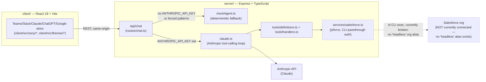

# Project Handoff — Sony Pictures Sales Cloud Headless

**Last verified**: 2026-11-06 (updated after Stage 4B-1 hardening), against a live inspection of this working directory (not from memory or prior chat — every claim below was checked against the actual filesystem, Git state, or CLI output on that date).

This document is self-contained. A new Claude Code session with no access to prior conversation history should be able to resume this project using only this file, `CLAUDE.md`, and the repository itself.

---

## 1. Project overview and demo objectives

**What this is**: A Sony Pictures Entertainment demonstration of **headless Salesforce CRM** — showing that a single AI agent backend can power multiple chat-style frontends ("Microsoft Teams," "Slack," "ChatGPT," "Google Chat," "Claude") while all CRM logic, intelligence, and Salesforce access live in one Express backend. The pitch: *"one AI agent backend, any chat frontend — the UI is a skin, the intelligence lives in the backend."*

**The Microsoft Teams-style UI**: `client/src/sony/TeamsScene.tsx` and related components render a **visual reproduction of a Microsoft Teams chat interface** — styling, layout, iconography, and interaction patterns designed to look and feel like Teams. **This is not a native Microsoft Teams integration.** There is no Teams Bot Framework, no Microsoft Graph API, no Teams app manifest, and no connection to any real Teams tenant anywhere in this codebase. It is a themed skin over this app's own chat UI, exactly like the Claude/Slack/ChatGPT/Google Chat skins. Any demo narration or documentation must say so if asked — do not let copy imply a real Teams integration exists.

**Decoupled frontend / headless CRM goal**: The architecture goal is to prove that a React frontend talking only to this app's own Express API (never directly to Salesforce) can deliver a CRM experience indistinguishable, from the user's perspective, from a native Salesforce UI — Accounts, Contacts, Opportunities, searches, and eventually write actions, all mediated through backend tool-calling rather than a Salesforce-rendered page.

**Important terminology correction (carried from CLAUDE.md)**: "Headless" in this project refers to **headless Salesforce CRM** (a decoupled frontend consuming Salesforce only through APIs) — it is *not* Salesforce's "Sales Cloud Headless" as a named product, and should never be described as such.

---

## 2. Architecture and technology

### Monorepo structure (npm workspaces)

```
SPE-sales-cloud-headless/
├── client/          React 18 + Vite 6 + TypeScript (workspace: "client")
├── server/          Express + TypeScript, ESM (workspace: "server")
├── shared/          Shared TS types, no build step (workspace: "shared")
├── tests/           Node test runner specs (28 .test.ts/.test.tsx files)
├── Procfile         Heroku process declaration
├── CLAUDE.md        Project instructions / guardrails
├── DEMO_SCRIPT.md   193-line presenter script for the existing IP360-style demo
└── .env.example     Documents expected env var NAMES (no real values)
```

### Technology stack
- **Frontend**: React 18.3, Vite 6, TypeScript 5.7, `react-markdown` + `remark-gfm` (chat message rendering), `recharts` (charts in chat responses), `uuid`.
- **Backend**: Express 4.22, TypeScript 5.7 (ESM, `node --import tsx` in dev, compiled via `tsc` for production), `@anthropic-ai/sdk` 0.39, `jsforce` 1.11 (Salesforce API client), `cors`, `dotenv`.
- **Shared**: a types-only package (`shared/src/types.ts`), imported by both client and server, no independent build.

### Key components and services

| Concern | Path |
|---|---|
| Server entrypoint | [server/src/index.ts](server/src/index.ts) |
| Server config / env resolution | [server/src/config.ts](server/src/config.ts) |
| Live Claude tool-calling agent | [server/src/services/claude.ts](server/src/services/claude.ts) |
| Mock/deterministic fallback agent | [server/src/services/mockAgent.ts](server/src/services/mockAgent.ts) (684 lines) |
| Salesforce connection + queries | [server/src/services/salesforce.ts](server/src/services/salesforce.ts) |
| Tool schemas (Anthropic tool definitions) | [server/src/tools/definitions.ts](server/src/tools/definitions.ts) |
| Tool execution handlers | [server/src/tools/handlers.ts](server/src/tools/handlers.ts) |
| Claude system prompt | [server/src/prompts/system.ts](server/src/prompts/system.ts) |
| Chat route (live/mock dispatch) | [server/src/routes/chat.ts](server/src/routes/chat.ts) |
| Activation-link route (Sony-specific) | [server/src/routes/activation.ts](server/src/routes/activation.ts) |
| Optional live executive-brief route | [server/src/routes/liveBrief.ts](server/src/routes/liveBrief.ts) |
| Sony-themed scene components (Teams/Slack/Claude skins) | [client/src/sony/](client/src/sony/) |

### Current Salesforce integration and authentication approach

**This is the most important thing to understand about the current state**: Salesforce access today is **not** a deployable auth strategy.

[server/src/services/salesforce.ts](server/src/services/salesforce.ts) authenticates by shelling out to the Salesforce CLI:
```ts
exec('sf org display --target-org headless --json', ...)
```
This reads cached CLI credentials for an org **aliased `headless`**. It depends on a local `sf` CLI session on the machine running the server — **it has no meaning on a Heroku dyno**, which has no `sf` CLI installed and no cached org session. This is a local-developer-machine placeholder only.

**Verified fact**: running `sf org list` in this environment shows **no org aliased `headless` exists**. Existing aliases are `agentforce-comms-demo` (broken refresh token), `crunchyroll-demo`, `ip360`, `mcr-source-test`, `netgear-demo`, `sie-forecast-demo`, `sie-influencer-cdo`, and `sony-scout-demo` (default). **No dedicated demo org for this project has been selected or connected.** Any code path that calls `getSalesforceConnection()` will fail locally too, not just on Heroku, until either a `headless`-aliased org is authenticated via `sf org login`, or the auth approach is replaced with OAuth (per CLAUDE.md's requirement).

Because of this, **every tool call that hits Salesforce currently fails** — but this doesn't break the demo, because of the mock fallback below.

### Mock fallback architecture

[server/src/services/mockAgent.ts](server/src/services/mockAgent.ts) is a large, deterministic, pattern-matched response generator that returns realistic chat content (quota gauges, KPI cards, pipeline funnels, alert cards) **without touching Salesforce or Anthropic at all**. [server/src/routes/chat.ts](server/src/routes/chat.ts) decides which path to use:

- A hardcoded `useLiveAgent` in-memory flag (toggled via `POST /api/agent-mode`, defaults to `true`).
- But live mode only actually fires if `config.anthropic.apiKey` is non-empty (`chat.ts:63`, `useLiveAgent && config.anthropic.apiKey`) — with no `ANTHROPIC_API_KEY` set, **every chat request silently falls through to mock mode**, regardless of the `useLiveAgent` flag's displayed state.
- Certain hardcoded prompt patterns (`EXACT_DISTRIBUTION_DEAL_PROMPTS`, `DISTRIBUTION_DEALS_INTENT` regex in `chat.ts`) are **forced to mock mode regardless of live/mock setting**, to keep a specific demo beat deterministic.

**Verified by direct test** (this session, ports killed afterward): with zero environment variables set (simulating a bare Heroku dyno), the server starts, `/api/health` returns `200 {"status":"ok","salesforce":"disconnected"}`, and `POST /api/chat` returns a full mock response with charts. The demo fully functions with no Salesforce and no Anthropic credentials.

### Claude-powered tool-calling (current) vs. future Agentforce/MCP (not built)

- **Current, built, and working** (when `ANTHROPIC_API_KEY` is set and a real `sf`-authenticated org exists): [server/src/services/claude.ts](server/src/services/claude.ts) runs an Anthropic tool-calling loop using the tool schemas in `definitions.ts` and handlers in `handlers.ts`, which call into `salesforce.ts`'s `jsforce`-based SOQL/SOSL/SOAP functions. This is Anthropic's Claude model acting as a tool-calling agent — **it is not Salesforce Agentforce**, and must never be described as such (distinct vendors, distinct products).
- **Not built, future only**: Salesforce Agentforce integration, an MCP-based integration, and "Headless 360" as a named future capability. None of these exist in this codebase today. Do not imply otherwise in code, UI copy, or demo narration.

### Architecture diagram



---

## 3. Completed work

All of the following has been verified in this session, not assumed from prior documentation:

1. **Independent project duplication** — this directory (`/Users/benglund/DevProjects/SPE-sales-cloud-headless`) is a separate git clone of the original IP360 project. Its reflog shows exactly: `clone: from /Users/benglund/DevProjects/SPE-seller-demo-app` followed by one local commit. No remotes pointed at the original project at any point in this checkout's history.
2. **Original IP360 preservation** — verified in this session: `/Users/benglund/DevProjects/SPE-seller-demo-app` is still at commit `bd8934e` with its own `heroku` remote pointing only to `luminary-rights-demo`. No commits, pushes, or deploys have touched it from this project.
3. **Build and test verification** — `npm ci`, `npm run build` (client `tsc && vite build` + server `tsc`), and `npm test` (Node test runner, `tests/*.test.ts(x)`) all verified passing: **299/299 tests pass**, build succeeds for both client and server workspaces. (Re-verify before relying on this — see Section 9.)
4. **CLAUDE.md creation and approval** — [CLAUDE.md](CLAUDE.md) was drafted, reviewed against explicit user-specified guardrails across two review rounds, and approved. It documents architecture, IP360 isolation, security boundaries (including backend-enforced write confirmation and server-side-only OAuth requirements), framing rules, dev workflow, and known gaps.
5. **GitHub repository setup** — a new, independent, **private** GitHub repository was created at `https://github.com/benglund54/SPE-sales-cloud-headless.git`. `origin` is configured to this URL. The `feature/sony-headless-360` branch (34 original commits + 1 new `CLAUDE.md` commit = 35 total) was pushed. Verified in this session via a fresh `git fetch` + `git diff origin/feature/sony-headless-360 feature/sony-headless-360`: **zero diff, both at `992827a`.**
7. **Stage 4B-1 — Pre-deployment hardening** (completed, committed locally, **not yet pushed**):
   - Node pinned: root `package.json` now has `engines.node = "22.x"`.
   - Express dependency patches applied (lockfile-only, within existing ranges): `express` 4.22.3, `body-parser` 1.20.9, `proxy-addr` 2.0.8, Express's own `qs` 6.16.2. `server/package.json` unchanged.
   - `/api/health` simplified: returns static `{status:"ok"}`; no Salesforce import, no `sf` CLI call.
   - Production agent-mode disabled: in `NODE_ENV=production`, `POST /api/agent-mode` returns 403 and `GET` returns `{live:false, locked:true}`; the chat route can never take the live path in production. Local dev keeps the Live/Mock toggle. No shared secret is used.
   - CORS middleware removed from `server/src/index.ts` (app is same-origin). The `cors` package remains in `server/package.json` unused.
   - UI toggle updated (`ThemeSwitcher.tsx`): disabled and labelled "Mock" when the server reports `locked`.
   - Tests: new `tests/hardeningHx.test.ts` (6 tests); **305/305 passing**, build clean.
   - Production audit (`npm audit --omit=dev`): 10 → **8 findings, including 3 critical** (all via `jsforce`'s legacy chain). `body-parser` and `proxy-addr` findings resolved. Full audit still 18 findings.
   - Verified with a production-mode run and zero credentials: health 200, no CORS headers, agent-mode POST 403, mock chat works, `/` serves.
6. **Stage 4A — Heroku deployment readiness assessment** (read-only, completed): confirmed the app boots and the mock demo works fully with zero config vars; ran `npm audit` (20 findings: 6 critical/6 high/6 moderate/2 low) and `npm audit --omit=dev` (10 production-path findings: 4 critical/1 high/5 moderate); traced each production finding to its dependency chain; identified two pre-deployment concerns (unauthenticated `/api/agent-mode` toggle, unauthenticated CLI-shelling `/api/health`); confirmed Heroku CLI is installed but **not authenticated** in this environment; confirmed no `engines` field exists in any `package.json`; proposed the `heroku git:remote` + `git push heroku feature/sony-headless-360:main` deployment method. **No Heroku app was created.**

### Relevant commits / checkpoints
- `992827a` — `Add project instructions for Sony Sales Cloud Headless` (HEAD, current)
- `bd8934e` — `Retarget the Claude preloaded prompt to the Brand New Day opportunity` (last commit inherited from the IP360 clone; also still HEAD of the original project, confirming the fork point)
- `14a14eb` — `Prepare Heroku deployment` (oldest commit in this history — an IP360-era Heroku prep commit, predates this project's own Heroku work; do not confuse with the *new, not-yet-created* `spe-sales-cloud-headless` Heroku app)

---

## 4. Current project state (verified live, this session)

> **Stage 4B-1 update**: HEAD is now the Stage 4B-1 hardening commit ("Harden mock-only deployment and update project handoff"), on top of `992827a`; it is local only and **not pushed** to `origin` until approved. Where the bullets below say HEAD is `992827a`, clean tree, or 299 tests, that is the pre-4B-1 baseline. Still true: no Heroku app or `heroku` remote, no Salesforce connection, no `.env`.

- **Working directory**: `/Users/benglund/DevProjects/SPE-sales-cloud-headless`
- **Branch**: `feature/sony-headless-360`
- **HEAD**: `992827a` ("Add project instructions for Sony Sales Cloud Headless")
- **Status**: clean — `git status` reports "nothing to commit, working tree clean"; `git diff --stat HEAD` is empty; no untracked files
- **Remotes**: `origin` only → `https://github.com/benglund54/SPE-sales-cloud-headless.git` (fetch+push). **No `heroku` remote exists.**
- **Local vs GitHub**: confirmed identical — `git rev-parse HEAD` and `git rev-parse origin/feature/sony-headless-360` both resolve to `992827aa7f06fab89eff425f57968df14b103356` after a fresh fetch.
- **Total commits**: 35 (oldest: `14a14eb` "Prepare Heroku deployment", from the original IP360 lineage; newest: `992827a`).
- **Heroku deployment status**: **not started.** No Heroku app has been created for this project, no `heroku` git remote exists, and Heroku CLI (`v11.4.0`, installed) returned `401 Invalid credentials` when checked in this session — it is not authenticated here. Stage 4A (assessment) is complete; **Stage 4B (actually creating the app) has not begun.**
- **Salesforce authentication status**: **not configured for this project.** No `.env` file exists in this checkout. `sf org list` shows no org aliased `headless` (the alias the code expects). Several unrelated demo-org aliases exist on this machine (`ip360`, `sony-scout-demo`, etc.) but none has been designated or connected for this project.
- **node_modules / build artifacts**: present (`node_modules`, `server/dist`, `client/dist` all exist from the Stage 2/4A verification work), but these are gitignored and not part of repo state.
- **Incomplete / pending work**: Heroku app creation (blocked on `heroku login`), Salesforce demo org selection + OAuth setup (not started), real CRM connectivity (not started — all current chat responses are mock-only in practice since no `ANTHROPIC_API_KEY` or working Salesforce org exists), the recommended `engines` field in `package.json` (proposed, not yet added — requires separate approval per CLAUDE.md), and any npm audit remediation (assessed, not remediated).

**Do not assume anything beyond the above is done.** In particular: no live Salesforce connectivity has ever been demonstrated in this project (only mock mode has been verified end-to-end).

---

## 5. Remaining implementation stages

| Stage | Status | Notes |
|---|---|---|
| Stage 1 — Independent clone | ✅ Done | Verified in Section 3/4 |
| Stage 2 — Install/build/test verification | ✅ Done | 299/299 tests, build clean |
| Stage 3 — GitHub repository setup | ✅ Done | Private repo, pushed, verified byte-identical to local |
| **Stage 4A — Heroku deployment readiness & security assessment** | ✅ Done (read-only) | See Section 3, item 6 |
| **Stage 4B-1 — Pre-deployment hardening** | ✅ Done (committed locally, not pushed) | See Section 3, item 7. 305/305 tests |
| **Stage 4B-2 — Create independent Heroku app + initial deployment** | ⏳ Next (not started). **Access control must be decided before public deployment** | Blocked on `heroku login` (CLI not authenticated here). App name `spe-sales-cloud-headless` proposed but **availability not yet verified** |
| Salesforce CRM demo org selection | ❌ Not started | No org has been chosen or aliased `headless`. This is a decision point for the user, not something to infer |
| Secure server-side OAuth authentication | ❌ Not started | CLAUDE.md requires JWT bearer flow or Connected App OAuth; current CLI-passthrough approach is explicitly disallowed for any deployment |
| Connect Teams-style UI to real Salesforce backend | ❌ Not started | Currently only mock-mode has been exercised end-to-end |
| Account/Contact/Opportunity retrieval (live) | 🔶 Code exists, unverified | `tools/handlers.ts` + `services/salesforce.ts` have the SOQL/SOSL logic from the original IP360 build, but it has never been run against a real connected org in this project |
| Opportunity updates + follow-up Task creation with backend-enforced approval | ❌ Not started | CLAUDE.md requires the backend itself (not just the system prompt) to hold and gate the specific proposed write action — no such enforcement code exists yet. Current `convertLead` function in `salesforce.ts` has no backend confirmation gate at all |
| Agentforce integration | ❌ Not started / future | Explicitly out of scope until named and approved separately |
| Sony-specific sales scenarios, final demo prep | 🔶 Partially exists | The *original* IP360 Sony scenarios (`client/src/sony/`, `DEMO_SCRIPT.md`) are intact and working; **no new Sales-Cloud-Headless-specific scenario work has been done** — CLAUDE.md explicitly says not to modify these until asked |

---

## 6. Exact next steps

### 0. Address access control before any public deployment (new, required)
- The app serves all Sony demo content (scenes, mock deal data) to anyone with the URL, and `/api/chat` is unauthenticated. Decide on protection (e.g., HTTP basic auth in front of the app, an auth proxy, or an internal-only/unguessable URL) **before** Stage 4B-2. Not yet implemented; needs explicit approval.

### 1. Authenticate Heroku CLI and verify app name availability
- **Objective**: Unblock Stage 4B by establishing Heroku CLI auth and confirming `spe-sales-cloud-headless` (or an alternative name) is free.
- **Required files**: none (CLI-only).
- **Prerequisites**: user runs `heroku login` interactively (opens browser) — cannot be automated by Claude.
- **Approach**: `heroku login`, then `heroku apps:info --app spe-sales-cloud-headless` — a `404`/"Couldn't find that app" response confirms availability; any other response means check with the user before reusing a name.
- **Tests/verification**: `heroku auth:whoami` returns the expected account.
- **Risks**: logging in under the wrong Heroku account/team could create the new app in an unintended place.
- **Approval checkpoint**: user must run `heroku login` themselves; Claude should not proceed to `heroku create` without explicit go-ahead naming the exact app name and target account/team.

### 2. Decide and connect a dedicated Salesforce demo org
- **Objective**: Pick which Salesforce org this project will demo against, and authenticate it via `sf org login` under a clear alias (the code currently expects alias `headless` — this should be revisited alongside the OAuth rework, not just re-aliased blindly).
- **Required files**: [server/src/services/salesforce.ts](server/src/services/salesforce.ts) will need rework regardless (see next step).
- **Prerequisites**: user must decide/provision the org — Claude must not invent or assume which org to use. None of the existing aliases (`ip360`, `sony-scout-demo`, etc.) have been confirmed as intended for this project.
- **Approach**: once chosen, document the alias and purpose in this handoff and in CLAUDE.md's "Salesforce environment" understanding — but do not record credentials anywhere.
- **Tests/verification**: `sf org display --target-org <alias>` succeeds; a simple SOQL smoke test (e.g. `SELECT Id FROM Account LIMIT 1`) via the CLI, outside the app, before wiring up app code.
- **Risks**: connecting the wrong org, or an org with production data, to a demo app.
- **Approval checkpoint**: explicit user confirmation of which org before any code changes connect to it.

### 3. Replace CLI-passthrough Salesforce auth with server-side OAuth
- **Objective**: Satisfy CLAUDE.md's non-negotiable requirement — implement JWT bearer flow or Connected App OAuth in `salesforce.ts`, reading only from Heroku config vars / server-side env, never from a CLI session.
- **Required files**: [server/src/services/salesforce.ts](server/src/services/salesforce.ts), [server/src/config.ts](server/src/config.ts) (new env var names), `.env.example` (update placeholder names only).
- **Prerequisites**: Step 2 (org chosen) and a Connected App / JWT keypair provisioned in that org.
- **Approach**: swap `fetchCliCredentials()` for a jsforce JWT bearer flow (`jsforce.Connection` with `privateKey` + `clientId` + `username`) or OAuth2 client-credentials, per CLAUDE.md.
- **Tests/verification**: run the existing test suite (must stay green — mock fallback must be unaffected), then a manual live smoke test of `GET /api/health` showing `salesforce: connected` with real OAuth, no CLI dependency.
- **Risks**: breaking the mock-fallback path if auth code is not properly isolated/lazy; accidentally logging secrets.
- **Approval checkpoint**: this is an application-code change — explicit approval required before editing `salesforce.ts`/`config.ts`, per CLAUDE.md's "no code changes without approval" pattern established across prior stages.

### 4. Execute Stage 4B — create Heroku app and deploy current mock-mode build
- **Objective**: Stand up `spe-sales-cloud-headless` (or approved alternate name) on Heroku, reproducing the existing mock-mode demo publicly.
- **Required files**: none beyond what exists (`Procfile`, `heroku-postbuild`). Optionally add `engines` to root `package.json` first (separate approval).
- **Prerequisites**: Step 1 complete (Heroku authenticated, name verified).
- **Approach**: `heroku create <name>`, `heroku git:remote -a <name>`, set no/minimal config vars (see Stage 4A report — none required for mock-mode-only), `git push heroku feature/sony-headless-360:main`.
- **Tests/verification**: hit the deployed `/api/health` and `/` endpoints; click through the UI; run the Stage 4A verification checklist (including confirming `luminary-rights-demo` is unaffected).
- **Risks**: accidentally reusing/colliding with the original app name; audit findings (4 critical in production path) remain unremediated at this point — acceptable for a controlled/internal URL, not yet for wide public sharing.
- **Approval checkpoint**: explicit approval already scoped in Stage 4A report; needs renewed confirmation of exact app name/account before `heroku create` runs.

### 5. Triage production-path npm audit findings before any public-facing sharing
- **Objective**: Address CLAUDE.md's pre-deployment security gate — determine real exploitability of the 10 production-path findings (4 critical: `request`, `form-data`, `proxy-addr`, `websocket-driver`) and remediate the genuinely reachable ones.
- **Required files**: likely `server/package.json` (jsforce version or replacement), possibly `server/src/services/salesforce.ts` if jsforce is replaced.
- **Prerequisites**: Step 3 (OAuth rework) is a natural point to also reassess whether `jsforce` itself should be upgraded/replaced, since many findings trace through it.
- **Approach**: do not run `npm audit fix --force` blindly; scope exactly which packages to bump, test for breakage.
- **Tests/verification**: full build + test suite must stay green after any dependency change; re-run `npm audit --omit=dev` to confirm reduction.
- **Risks**: `jsforce` is old (1.11) and a major bump may be breaking.
- **Approval checkpoint**: explicit, separate approval — CLAUDE.md is explicit that dependency changes are never a side effect of other work.

---

## 7. Important files and directories

| Purpose | Path |
|---|---|
| Teams-style skin / all Sony scene components | [client/src/sony/](client/src/sony/) — `TeamsScene.tsx`, `SlackScene.tsx`, `ClaudeScene.tsx`, `SonyExperience.tsx`, `SceneNavigator.tsx`, `ActivationLink.tsx`, `PresenterPanel.tsx`, etc. |
| Other theme CSS (Claude/ChatGPT/Google/Slack/Teams visual skins) | [client/src/themes/](client/src/themes/) |
| Chat UI components | [client/src/components/Chat/](client/src/components/Chat/) |
| Express entrypoint | [server/src/index.ts](server/src/index.ts) |
| Server config/env resolution | [server/src/config.ts](server/src/config.ts) |
| Chat route (live/mock dispatch logic) | [server/src/routes/chat.ts](server/src/routes/chat.ts) |
| Activation route | [server/src/routes/activation.ts](server/src/routes/activation.ts) |
| Optional live executive-brief route | [server/src/routes/liveBrief.ts](server/src/routes/liveBrief.ts) |
| Salesforce service (auth + SOQL/SOSL/SOAP) | [server/src/services/salesforce.ts](server/src/services/salesforce.ts) |
| Tool handlers (executes tool calls against Salesforce) | [server/src/tools/handlers.ts](server/src/tools/handlers.ts) |
| Tool schema definitions (Anthropic tool specs) | [server/src/tools/definitions.ts](server/src/tools/definitions.ts) |
| Claude tool-calling loop | [server/src/services/claude.ts](server/src/services/claude.ts) |
| Claude system prompt | [server/src/prompts/system.ts](server/src/prompts/system.ts) |
| Mock agent fallback | [server/src/services/mockAgent.ts](server/src/services/mockAgent.ts) |
| Shared types | [shared/src/types.ts](shared/src/types.ts) |
| Tests (28 files) | [tests/](tests/) |
| Env var names reference (no values) | [.env.example](.env.example) |
| Git/deployment config | [Procfile](Procfile), root [package.json](package.json) (`heroku-postbuild` script) |
| Project instructions/guardrails | [CLAUDE.md](CLAUDE.md) |
| Existing presenter demo script | [DEMO_SCRIPT.md](DEMO_SCRIPT.md) |
| This handoff | [PROJECT_HANDOFF.md](PROJECT_HANDOFF.md) |

---

## 8. Salesforce environment

**Verified, not planned:**
- `sf org list` (run in this session) shows these aliases available on this machine: `agentforce-comms-demo` (session refresh broken), `crunchyroll-demo`, `ip360`, `mcr-source-test`, `netgear-demo`, `sie-forecast-demo`, `sie-influencer-cdo`, `sony-scout-demo` (currently the default org).
- **None of these is aliased `headless`**, which is what [server/src/services/salesforce.ts](server/src/services/salesforce.ts) currently hardcodes (`sf org display --target-org headless`). That exec call will fail as-is.
- No `.env` file exists in this checkout — no Salesforce credentials of any kind are configured for this project currently.

**Not yet decided (do not infer an answer)**:
- Which org (if any of the above, or a new one) should serve as this project's demo org.
- Whether `ip360`'s org (used by the original demo) should be reused, or whether a fresh org is more appropriate for isolation from the original project's data/configuration.

**Relevant Salesforce objects referenced in existing code** (from `tools/definitions.ts` and `tools/handlers.ts`, inherited from the original IP360 build — not yet exercised against a connected org in this project):
- **Opportunity** — `get_top_opportunities`, `get_opportunity_details` (by Id or Name)
- **Account** — `get_account_details` (by Id or Name), including related contacts and open opportunities
- **Lead** — `get_lead_details`, `get_recent_leads`, `convert_lead` (SOAP `convertLead` call via jsforce)
- **Contact** — referenced in account detail retrieval and in `search_records`
- Cross-object keyword search via SOSL (`search_records`, object types: Account/Contact/Lead/Opportunity)

**Existing SOQL/SOSL/SOAP operations** (code-level, unverified against a live org in this project): `querySalesforce<T>(soql)`, `searchSalesforce(sosl)`, `convertLead(params)` — all in [server/src/services/salesforce.ts](server/src/services/salesforce.ts).

**Authentication limitations (current)**: CLI-passthrough only, as described throughout this document. Not viable for Heroku. Must be replaced with JWT bearer or Connected App OAuth per CLAUDE.md before any live deployment uses real Salesforce data.

**Required future setup**: a Connected App (or equivalent) in the chosen demo org, with a JWT certificate/keypair or OAuth client credentials, provisioned server-side only (Heroku config vars), plus whatever profile/permission set grants the demo user read access to Account/Contact/Opportunity/Lead and (later, gated) write access to Opportunity/Task.

---

## 9. Running, testing, and deployment

### Install
```bash
npm ci
```
(workspace-aware; installs `client`, `server`, and `shared` together from `package-lock.json`)

### Development
```bash
npm run dev          # runs server + client concurrently
npm run dev:server   # server only
npm run dev:client   # client only
```

### Build
```bash
npm run build        # client: tsc && vite build; then server: tsc
```

### Test
```bash
npm test              # node --import tsx --test tests/*.test.ts tests/*.test.tsx
```

**Baseline results as of last verification (Stage 2, re-confirmed in Stage 4A)**: build succeeds for both workspaces (Vite warns about a >500KB chunk — informational only); **299/299 tests pass**. *A new session should re-run these before trusting this baseline — do not assume it still holds without checking (see Section 12, step 3).*

### Environment variable names (purpose only, never values)

| Variable | Purpose |
|---|---|
| `SF_LOGIN_URL` | Salesforce login endpoint (legacy username/password flow — see CLAUDE.md, should not be the final auth approach) |
| `SF_USERNAME`, `SF_PASSWORD`, `SF_SECURITY_TOKEN` | Legacy Salesforce credential fields inherited from `.env.example`'s placeholder shape — CLAUDE.md explicitly says not to blindly adopt these for the new OAuth approach |
| `SF_CLIENT_ID`, `SF_CLIENT_SECRET` | Referenced in `config.ts` for a Connected App OAuth flow, not currently wired into `salesforce.ts`'s actual connection logic (which uses CLI passthrough instead) |
| `ANTHROPIC_API_KEY` | Enables the live Claude tool-calling path; absent = mock-only |
| `PORT` | Server port (Heroku sets automatically) |
| `NODE_ENV` | Standard Node environment flag |
| `SALESFORCE_ACTIVATION_URL` | Browser-visible link destination only (Sony Activation feature) — never paired with a credential |
| `CLAUDE_MODEL` | Model identifier for the optional live executive-brief path |
| `LIVE_EXEC_BRIEF` | Master gate (`"true"` to enable) for the optional live executive-brief route; off by default |
| `CLAUDE_TIMEOUT_MS` | Timeout for the optional live executive-brief path |

### Git workflow
- Working branch: `feature/sony-headless-360` (not `main`) — this is the project's trunk until told otherwise.
- Remote: `origin` → `https://github.com/benglund54/SPE-sales-cloud-headless.git` (private repo, already pushed and verified in sync).
- No `heroku` remote exists yet.

### Deployment approach (Heroku) — planned, not yet executed
```bash
heroku login                                   # interactive, user must run
heroku apps:info --app spe-sales-cloud-headless   # verify name availability first
heroku create spe-sales-cloud-headless
heroku git:remote -a spe-sales-cloud-headless
git push heroku feature/sony-headless-360:main    # Heroku always deploys to its own "main" ref
```
**Blocker**: Heroku CLI is not authenticated in this environment (`401 Invalid credentials` as of last check). This must be resolved by the user before any `heroku create` can run.

---

## 10. Architectural decisions and guardrails (summarized from CLAUDE.md — read the full file, this is a summary only)

- **Never modify, commit to, push to, or deploy to** `SPE-seller-demo-app` or `luminary-rights-demo`, under any circumstance.
- **Salesforce credentials/tokens stay server-side always** — the React client must never hold a Salesforce session or credential.
- Salesforce auth for this project **must become server-side OAuth** (JWT bearer or Connected App flow); CLI-passthrough must not be carried into any deployment; do not blindly copy legacy `.env.example` username/password fields.
- **Maintain a working mock/demo fallback at all times** while adding real CRM connectivity — real integration work must not break or bypass `mockAgent.ts`.
- **Any Salesforce write action must be confirmed by backend application logic holding the specific proposed action** — not merely requested via LLM system prompt. (No such backend-enforced gate exists yet in the current code — this is a build task, not a completed feature.)
- **Distinguish this app's Claude tool-calling agent from actual Salesforce Agentforce** — different vendors, different products; name Agentforce explicitly if/when it's integrated.
- **Do not claim the Teams/Slack/ChatGPT/Google Chat skins are native integrations** with those products.
- **Verify build and tests before major implementation stages, and after changes** — don't silently disable/skip a failing test.
- **No commits, pushes, deployments, or cloud resource creation without explicit user approval** — and a prior approval does not imply approval for a logically-following next step; each is asked for separately.
- Before any public-facing Heroku deployment, **triage all npm audit findings for production/runtime exposure** — don't upgrade dependencies as a side effect of other work.

---

## 11. Known issues and security risks

- **npm audit (updated after Stage 4B-1)**: production path is now **8 findings (3 critical, 5 moderate)**, all via `jsforce`'s legacy chain; full audit 18. Not reachable in the mock-only deployment (`index.ts` no longer imports Salesforce; production never takes the live path) but must be fixed before any live Salesforce connection. Earlier baseline: 20 total findings (6 critical, 6 high, 6 moderate, 2 low) across all dependencies; **10 in the production path** (4 critical: `request`, `form-data`, `proxy-addr`, `websocket-driver`; 1 high: `body-parser`; 5 moderate: `jsforce` [direct], `qs`, `tough-cookie`, `csv-parse`, `uuid`). Most trace through `jsforce`'s legacy `request`-based HTTP client. **Not yet remediated** — requires its own scoped, approved task (see Section 6, step 5).
- **Salesforce CLI auth is fundamentally incompatible with Heroku** and currently points at a nonexistent org alias (`headless`) — this is not just "needs replacing before deploy," it is currently non-functional even in local dev beyond mock mode.
- **No backend-enforced write-confirmation mechanism exists yet** — `convertLead` in `salesforce.ts` executes immediately when called; CLAUDE.md's requirement for backend-held, explicitly-approved write actions is a design requirement for future work, not an implemented feature.
- **`POST /api/agent-mode`**: *resolved for production in Stage 4B-1* — returns 403 in production (still toggleable in local dev).
- **`GET /api/health`**: *resolved in Stage 4B-1* — static response, no CLI call.
- **CORS**: *resolved in Stage 4B-1* — middleware removed (same-origin app). Unused `cors` dependency remains.
- **Node version**: *resolved in Stage 4B-1* — `engines.node` `22.x`.
- **No access control on the public demo** (content and `/api/chat` open to anyone with the URL) — must be addressed before Stage 4B-2.
- **No dedicated Salesforce demo org has been selected** — this is an open decision, not a technical blocker, but nothing downstream (OAuth setup, live retrieval, write actions) can proceed without it.
- **Technical debt inherited from the original IP360 build**: `mockAgent.ts` (684 lines) and the hardcoded distribution-deal prompt matching in `chat.ts` are demo-specific scaffolding, not general-purpose code — expect this to need rework if the demo scenarios expand significantly.

---

## 12. New-session resume instructions

### START HERE — NEW CLAUDE CODE SESSION

Copy-paste this prompt into a new Claude Code session, with the working directory set to `/Users/benglund/DevProjects/SPE-sales-cloud-headless`:

```
Read CLAUDE.md and PROJECT_HANDOFF.md in this repository in full before doing anything else.

Then:
1. Verify the current working directory is /Users/benglund/DevProjects/SPE-sales-cloud-headless,
   confirm the Git branch, HEAD commit, working-tree status, and configured remotes — do not
   trust PROJECT_HANDOFF.md's recorded state without re-checking it live.
2. Diff what you find against what PROJECT_HANDOFF.md says was true as of its "Last verified"
   date — call out anything that has changed (new commits, new remotes, modified files,
   different audit findings, Heroku app now existing, etc.).
3. In under 60 seconds of reading time, summarize: what this project is, what's been completed,
   and what is NOT yet done (especially: no dedicated Salesforce org is connected, Salesforce
   auth is not yet OAuth-based, and no Heroku app exists yet as of the handoff).
4. Identify the exact next implementation stage from PROJECT_HANDOFF.md Section 6 ("Exact next
   steps"), adjusted for anything you found changed in step 2.
5. Recommend a Claude model and effort level appropriate to that next stage (e.g., routine
   verification/inspection tasks can run at a lower effort level; Salesforce OAuth
   implementation or write-confirmation backend logic should run at a higher effort level
   given the security sensitivity).
6. Present the next actionable plan or prompt to the user, referencing specific files and
   commands.
7. Do not modify any files, install or upgrade any packages, authenticate to Salesforce or
   Heroku, commit, push, or create any cloud resources until the user explicitly approves.
8. Wait for explicit approval before taking any action beyond this inspection and summary.
```

---

**End of handoff.**
